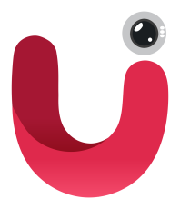
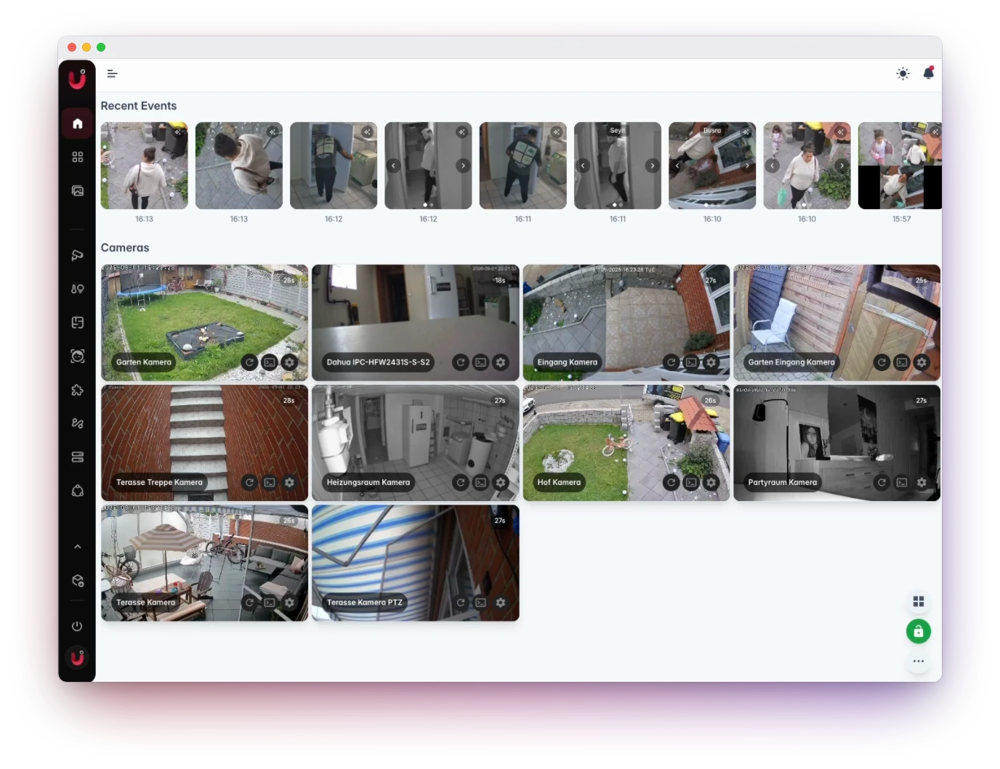

<p align="center">
  <a href="https://cameraui.com"></a>
</p>

<h1 align="center">camera.ui</h1>

<p align="center">Every camera you own. One app.</p>

<p align="center">
  <a href="https://www.npmjs.com/package/@camera.ui/server"></a>
  <a href="https://github.com/cameraui/camera.ui/pkgs/container/camera.ui"></a>
  <a href="./LICENSE.md"></a>
  <a href="https://discord.gg/bBGnGcbz8N"></a>
</p>

<p align="center">
  <a href="https://cameraui.com">Website</a> ·
  <a href="https://docs.cameraui.com">Docs</a> ·
  <a href="https://cameraui.com/download">Download</a> ·
  <a href="https://discord.gg/bBGnGcbz8N">Discord</a>
</p>

<p align="center">
  
</p>

camera.ui turns your IP cameras into one system on your own hardware: live view, detection, recordings and smart home. The server runs on macOS, Windows and Linux, in Docker, on Proxmox or as a Home Assistant app. You watch from the desktop app, the browser, your phone or your Apple TV.

## What it does

- **The cameras you have** over RTSP, ONVIF, HTTP and more, with plugins for brands like Reolink, Eufy and Ring and automatic discovery on your network.
- **Live view** of every camera on desktop, phone and TV, in layouts you arrange yourself.
- **Detection on your own hardware** for objects, faces and sounds, with zones, privacy masks and line crossing.
- **Recording** around the clock or on events, with a timeline to scrub through and MP4 export.\*
- **Episodes** turn related events into one story with an AI description.\*
- **Search** in plain words, or tap a person or car to find every moment it appeared.\*
- **Push notifications** with a video clip.\*
- **Smart home** with HomeKit, Home Assistant and MQTT.
- **Automations** you draw instead of code, and plugins for everything else.
- **Remote access** without port forwarding, and sharing a camera by link.
- **Hardware acceleration** on Apple Silicon, Intel, NVIDIA, AMD, Coral and Hailo, picked automatically.

<sub>\* Requires camera.ui Pro.</sub>

## Get started

**Desktop app** for macOS, Windows and Linux, server and viewer in one: [cameraui.com/download](https://cameraui.com/download)

**Docker** on Linux:

```sh
docker run -d --name cameraui \
  --restart unless-stopped --stop-timeout 30 \
  --network host -e TZ=Europe/Berlin \
  -v cameraui-data:/data \
  ghcr.io/cameraui/camera.ui:latest
```

Set `TZ` to your time zone. After a few minutes, open `https://<your-server>:3443` and sign in with `admin` / `admin`.

Proxmox, bare-metal Linux, GPU images and the apps for iPhone, Android and Apple TV are covered in the [installation guide](https://docs.cameraui.com/install/). On Home Assistant OS, install the [Home Assistant app](https://docs.cameraui.com/home-assistant/app).

## Questions and issues

Questions and help: [GitHub Discussions](https://github.com/cameraui/camera.ui/discussions), [Discord](https://discord.gg/bBGnGcbz8N) or [Reddit](https://www.reddit.com/r/cameraui/). The issues of this repository are only for bug reports and feature requests, please follow the [templates](https://github.com/cameraui/camera.ui/issues/new/choose). Report security vulnerabilities privately as described in the [Security Policy](./SECURITY.md).

## Contributing

This repository holds the server and the web interface. Plugins, SDKs, Docker images, the Home Assistant integration and the docs live in their own repositories in the [cameraui organization](https://github.com/cameraui).

Please read the [Contributing Guide](./CONTRIBUTING.md) and the [AI Policy](./AI_POLICY.md) before opening a pull request.

## License

[MIT](./LICENSE.md), Copyright (c) 2020-present [seydx](https://github.com/seydx)

The core of camera.ui is free and open source. Pro is a [subscription](https://cameraui.com) that funds ongoing development.
